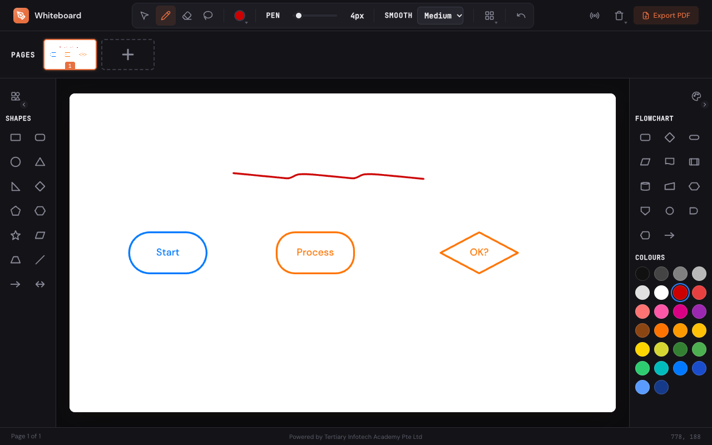

<div align="center">

# Whiteboard

[](https://developer.mozilla.org/en-US/docs/Web/HTML)
[](https://developer.mozilla.org/en-US/docs/Web/CSS)
[](https://developer.mozilla.org/en-US/docs/Web/JavaScript)
[](https://github.com/parallax/jsPDF)

[](https://alfredang.github.io/whiteboard/)

**A minimal, browser-based whiteboard with freehand drawing and flowchart tools, in a dark creative-studio aesthetic. Built for educators and trainers.**

[Live Demo](https://alfredang.github.io/whiteboard/) · [Report Bug](https://github.com/alfredang/whiteboard/issues) · [Request Feature](https://github.com/alfredang/whiteboard/issues)

</div>

## Screenshot



## About

Whiteboard is a lightweight, zero-dependency drawing application designed for classroom and training environments. It runs entirely in the browser with no backend or build step required — just open `index.html` and start drawing. Beyond freehand sketching, it includes a set of flowchart tools so you can build labelled diagrams (process boxes, decisions, connectors) right on the board.

### Key Features

| Feature | Description |
|---------|-------------|
| **Freehand pen** | Stabilised, curve-smoothed strokes that steady a shaky mouse (`B`), with an Off / Low / Medium / High smoothing control |
| **Hold to tidy** | Pause at the end of a pen stroke and it snaps to a clean line, circle, oval, rectangle or triangle |
| **Shift to constrain** | Hold `Shift` for a straight pen stroke, 45° lines and arrows, and perfect squares and circles |
| **Colour hotkey** | `Ctrl/Cmd + A` cycles the pen through six marker colours (`Shift` reverses) |
| **Shapes** | Rectangle (`R`), circle / oval (`O`), triangle, diamond, pentagon, hexagon, star and more, plus line (`I`), arrow (`A`) and double arrow, all with live preview |
| **Flowchart tools** | Process (`P`), decision (`D`), start / end (`G`), data, document, database and other nodes: drag to size, then type a centred, auto-wrapped label |
| **Snapping connectors** | Connector arrows (`C`) attach to boxes and follow them when they move |
| **Select & move** | Click or tap to select (`V`), drag to move, resize boxes by their corners, double-click a box to edit its label, `Delete` to remove |
| **Lasso select** | Circle several elements (`L`) to select them; a frame appears round the group. Drag inside it to move, drag a corner to scale everything together, handwriting included |
| **Selection action bar** | A floating bar beside the selection for touch and stylus (iPad): six quick colours, Smaller, Bigger and Delete, so no keyboard is needed |
| **Eraser with size ring** | A circle cursor shows the exact eraser size as you erase (`E`) |
| **Side rails** | Shapes sit in a rail on the left; flowchart elements and 26 colours sit in a rail on the right (scrolling rows above and below the board on a phone). Each rail starts collapsed to one button that opens and closes it. Tap a shape to pick the tool, or drag it onto the board to drop a ready-made shape; tap a colour for the pen and the selection |
| **Live session** | Start a session on the classroom PC, scan the QR code with an iPad (or enter the 6-character code) and both devices share one board in real time. Draw on the iPad and it appears on the projector |
| **Apple Pencil / stylus** | Pressure-sensitive line width and a light stabiliser tuned for a stylus. **Pencil-only mode with palm rejection**: an iPad starts Pencil-only, and any device switches to it once a stylus is used and remembers it. In Pencil-only mode fingers and the resting palm do nothing anywhere: they cannot draw, press the toolbar, switch or add pages, drag from the rails or use the selection bar; only the Pencil does. The hand button (tap it with the Pencil) turns fingers on; even then a touch that lands while the Pencil is down or just after it lifts, or a palm-sized contact on the board, is ignored, and a brief graze leaves no mark. A resting palm or long press never selects the page or opens the iPad Copy / Look Up menu |
| **Paper styles** | Whiteboard, paper or blackboard surface, each with a blank, lined, dotted or grid pattern; ink is recoloured when switching between light and dark |
| **Multi-page support** | Add, delete, navigate, and reset pages with live thumbnail previews |
| **Colour palette** | 26 swatches plus a custom colour picker; applies to the pen and to selected shapes |
| **Adjustable size** | Per-tool size slider (pen 1–50px, eraser 5–120px) |
| **Undo** | Per-page undo history (Ctrl/Cmd+Z, up to 30 states) |
| **PDF export** | All pages exported as a single landscape PDF document |
| **Auto-save** | Pages persist to `localStorage` across refreshes |
| **Mouse, touch and stylus** | Pointer events throughout, so strokes continue when the cursor leaves the canvas, and the canvas renders sharply on high-DPI screens |
| **Responsive layout** | Adapts to any screen size with smooth animations |

## Tech Stack

| Category | Technology |
|----------|------------|
| **Markup** | HTML5 Canvas |
| **Styling** | CSS3 (custom properties, animations, responsive) |
| **Logic** | Vanilla JavaScript (ES6+) |
| **PDF Export** | [jsPDF 3.0](https://github.com/parallax/jsPDF) (CDN) |
| **Fonts** | [DM Sans](https://fonts.google.com/specimen/DM+Sans) + [JetBrains Mono](https://fonts.google.com/specimen/JetBrains+Mono) |
| **Deployment** | GitHub Pages |

## Architecture

```
┌───────────────────────────────────────────────────────┐
│                        Browser                          │
│                                                         │
│  ┌──────────┐   ┌─────────────┐   ┌────────────┐        │
│  │  Header  │   │  Page Strip │   │ Status Bar │        │
│  │  Toolbar │   │  Thumbnails │   │  Coords    │        │
│  └────┬─────┘   └──────┬──────┘   └────────────┘        │
│       │                │                                │
│       ▼                ▼                                │
│  ┌──────────────────────────────────────────┐          │
│  │        HTML5 Canvas (1200×700)            │          │
│  │  ├── Freehand / Line / Circle             │          │
│  │  ├── Flowchart shapes + text labels       │          │
│  │  ├── Eraser (+ size ring) / Lasso select  │          │
│  │  ├── Snapshot preview + Undo stack (×30)  │          │
│  │  └── Per-page state                       │          │
│  └───────┬───────────────────────┬───────────┘          │
│          │                       │                      │
│          ▼                       ▼                      │
│  ┌────────────────┐     ┌──────────────────┐            │
│  │  localStorage  │     │   jsPDF (CDN)    │            │
│  │  auto-save     │     │  multi-page PDF  │            │
│  └────────────────┘     └──────────────────┘            │
└───────────────────────────────────────────────────────┘
```

## Project Structure

```
whiteboard/
├── index.html          # Toolbar, canvas, page strip, status bar, text editor overlay
├── styles.css          # Dark/light themes, responsive layout, animations, cursors
├── whiteboard.js       # Pen engine (smoothing, shape tidy), palm rejection, shapes & labels, pages, undo, PDF export
├── live.js             # Live sessions: Firebase sync, room code + QR join, shared undo
├── database.rules.json # Realtime Database access rules (deploy with the Firebase CLI)
├── firebase.json       # Firebase CLI config (points at database.rules.json)
├── .firebaserc         # Firebase project alias
├── .github/workflows/deploy.yml   # GitHub Pages deployment
├── preview.png         # Screenshot for README
└── README.md
```

## Getting Started

### Prerequisites

- Any modern web browser (Chrome, Firefox, Safari, Edge)

### Installation

```bash
git clone https://github.com/alfredang/whiteboard.git
cd whiteboard
```

### Usage

Open `index.html` directly in your browser, or serve it locally:

```bash
# Using Python
python3 -m http.server 8000

# Using Node.js
npx serve .
```

Then visit `http://localhost:8000`.

Or use the live version: **[https://alfredang.github.io/whiteboard/](https://alfredang.github.io/whiteboard/)**

### Keyboard Shortcuts

| Shortcut | Action |
|----------|--------|
| `V` | Select / move |
| `B` | Pen |
| `E` | Eraser |
| `L` | Lasso select |
| `R` | Rectangle |
| `O` | Circle / oval |
| `I` | Line |
| `A` | Arrow |
| `P` | Process box |
| `D` | Decision diamond |
| `G` | Start / end |
| `C` | Connector (snaps to boxes) |
| `Delete` / `Backspace` | Delete the selection |
| `Ctrl/Cmd + Z` | Undo |
| `Ctrl/Cmd + A` | Next pen colour (`Shift` for previous) |
| `Shift` + drag | Straight pen stroke, 45° lines, squares and circles |
| Hold still while drawing | Tidy the stroke into a line or shape |
| `PgUp` / `Ctrl + ←` | Previous page |
| `PgDn` / `Ctrl + →` | Next page |

> **Tip:** After drawing a flowchart node, a text field appears inside it — type your label and press `Enter` (`Shift+Enter` for a new line, `Esc` to leave it blank).

## Live sessions (Firebase)

Live sessions use Firebase Realtime Database in project `edtools-whiteboard-asia` (region `asia-southeast1`, Singapore). The web config is in `live.js`; it is not a secret. Access is controlled by `database.rules.json`:

- a room is readable and writable only by someone who knows its 6-character code;
- rooms cannot be listed;
- a room locks 48 hours after it was created;
- the host's **End session** deletes the room.

Deploy rule changes with `firebase deploy --only database`. The Firebase SDK and the QR library load only when a session starts or is joined, so the board still works offline as before.

A device that joins shows the host's board and leaves its own saved board untouched. Undo is shared: Ctrl+Z on the PC takes back the last stroke drawn on the iPad. Every device follows the page the last person switched to.

## Deployment

This project is deployed to **GitHub Pages** by the GitHub Actions workflow in `.github/workflows/deploy.yml`, which runs on every push to `main`. No build step is needed — the site is served as static HTML.

To deploy your own fork:

1. Fork this repository
2. Go to **Settings > Pages**
3. Set source to **GitHub Actions**
4. Push to `main`; your site will be live at `https://<your-username>.github.io/whiteboard/`

## Contributing

Contributions are welcome!

1. Fork the repository
2. Create your feature branch (`git checkout -b feature/amazing-feature`)
3. Commit your changes (`git commit -m 'Add amazing feature'`)
4. Push to the branch (`git push origin feature/amazing-feature`)
5. Open a Pull Request

For questions or suggestions, use [GitHub Discussions](https://github.com/alfredang/whiteboard/discussions).

## Developed By

**Tertiary Infotech Academy Pte Ltd**

## Acknowledgements

- [jsPDF](https://github.com/parallax/jsPDF) — Client-side PDF generation
- [DM Sans](https://fonts.google.com/specimen/DM+Sans) & [JetBrains Mono](https://fonts.google.com/specimen/JetBrains+Mono) — Typography
- [Google Fonts](https://fonts.google.com/) — Font delivery

## License

MIT

---

<div align="center">

If you found this useful, please consider giving it a star!

</div>
